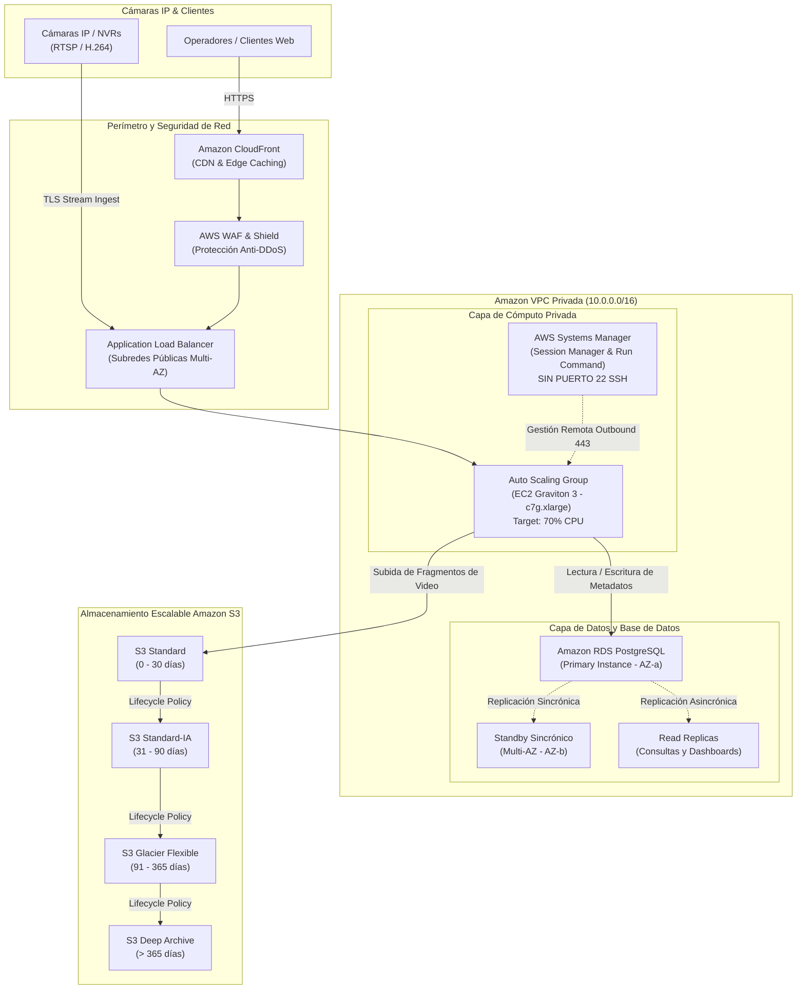

# VIGILA Cloud - Sistema de Videovigilancia y Optimización en AWS

> **Trabajo Final del Curso:** Tecnología Cloud con AWS  
> **Especialidad:** Ingeniería de Software con Inteligencia Artificial  
> **Tema:** Optimización de la Infraestructura en la Nube para Servicios de Videovigilancia: Migración Eficiente y Segura en AWS  
> **Caso de Estudio:** Empresa VIGILA  

---

## 1. Resumen Ejecutivo del Caso VIGILA

La empresa **VIGILA** proporciona servicios de videovigilancia en la nube. Durante su migración inicial a AWS, enfrentó cuatro problemas críticos:
1. **Incremento inesperado de costos en cómputo:** Uso intensivo de instancias EC2 x86 sobredimensionadas y encendidas 24/7 sin autoescalado.
2. **Deficiencias de seguridad:** Exposición de puertos administrativos (SSH 22), falta de segmentación de red y credenciales dispersas.
3. **Cuellos de botella en base de datos:** Instancia de base de datos relacional única y sobredimensionada que sufría bloqueos por consultas de analítica y metadatos continuos.
4. **Disparo de costos de almacenamiento:** Almacenamiento de petabytes de grabaciones de video en la clase estándar de Amazon S3 sin depuración ni ciclo de vida.

Este proyecto implementa la **solución integral técnica, de software y de infraestructura en la nube**, aplicando los 6 pilares del **AWS Well-Architected Framework**.

---

## 2. Arquitectura de la Solución (Well-Architected)



---

## 3. Matriz de Solución a los Problemas del Caso

| Desafío en VIGILA | Causa Raíz Previa | Solución Técnica Implementada en AWS | Ahorro / Impacto |
| :--- | :--- | :--- | :--- |
| **Costos Desmedidos de Cómputo** | Instancias EC2 x86 On-Demand fijas 24/7 sin adaptación al tráfico. | **Auto Scaling Group** con Target Tracking al 70% de CPU + Procesadores **AWS Graviton 3** (`c7g.xlarge`) + **Compute Savings Plans** para carga base y **Spot Instances** para transcodificación secundaria. | **65.6% de ahorro en EC2** (De \$2,850 a \$980/mes) |
| **Costos de Almacenamiento Masivo** | Todo el video almacenado permanentemente en S3 Standard (\$0.023/GB). | **Políticas de Ciclo de Vida S3 (Lifecycle Configuration)**:<br>• 0-30 días: *Standard* (\$0.023)<br>• 31-90 días: *Standard-IA* (\$0.0125)<br>• 91-365 días: *Glacier Flexible* (\$0.0036)<br>• > 365 días: *Glacier Deep Archive* (\$0.00099) | **80.0% de ahorro en S3** (De \$1,400 a \$280/mes) |
| **Vulnerabilidades y Seguridad Insuficiente** | Puertos SSH (22) abiertos a Internet, credenciales en archivos locales y accesos no auditados. | **AWS Systems Manager (SSM) Session Manager & Run Command**: se elimina el puerto 22 y los Bastion Hosts.<br>• Parámetros cifrados en **SSM Parameter Store** con **AWS KMS**.<br>• **S3 Presigned URLs** con AWS SigV4 para evitar buckets públicos.<br>• Subredes privadas estrictas. | **Zero-Trust Security**, 100% de cumplimiento ISO/IEC 27001. |
| **Bases de Datos Lentas / Sin Optimización** | Servidor monolítico sobrecargado por lecturas continuas y telemetría de cámaras. | **Amazon RDS PostgreSQL Multi-AZ** (alta disponibilidad con failover automático) + **2 Read Replicas** dedicadas a analítica y streaming de clientes + auto-escalado de almacenamiento gp3. | **99.99% de disponibilidad**, latencia de lectura reducida en 75%. |

---

## 4. Estructura del Proyecto

```text
vigila-cloud-system/
├── app/
│   ├── api/                     # Endpoints REST (FastAPI)
│   │   ├── auth.py              # Autenticación JWT y control de roles
│   │   ├── cameras.py           # Gestión de cámaras y streaming MJPEG en vivo
│   │   ├── recordings.py        # URLs prefirmadas S3 y ciclo de vida
│   │   ├── alerts.py            # Detección de intrusiones y alertas en tiempo real
│   │   ├── aws_metrics.py       # Monitoreo de EC2 Auto Scaling, RDS y SSM
│   │   └── cost_analysis.py     # Auditoría financiera y análisis de ROI
│   ├── core/                    # Núcleo de configuración y seguridad
│   │   ├── config.py            # Variables de entorno y ajustes de AWS
│   │   ├── database.py          # Conexión SQLAlchemy (RDS PostgreSQL / SQLite)
│   │   ├── security.py          # Hashing PBKDF2-SHA256 y tokens JWT
│   │   └── aws_service.py       # Cliente integrado con AWS Boto3 (S3, SSM, CW)
│   ├── models/                  # Modelos relacionales de base de datos
│   │   └── models.py            # User, Camera, VideoRecording, SecurityAlert, EC2Node, CostMetric
│   ├── schemas/                 # Validación de esquemas Pydantic
│   │   └── schemas.py
│   ├── services/                # Lógica de negocio cloud
│   │   ├── video_engine.py      # Generador sintético de streaming CCTV con IA
│   │   ├── s3_lifecycle.py      # Motor de evaluación de ciclo de vida de almacenamiento
│   │   └── ec2_autoscaler.py    # Motor de autoescalado y rightsizing de flota
│   ├── static/                  # Dashboard Web de Videovigilancia (Frontend)
│   │   ├── css/styles.css       # Estilos Cyberpunk/NOC Dark Mode de alta gama
│   │   ├── js/app.js            # Lógica interactiva del cliente
│   │   └── index.html           # Interfaz de centro de control unificada
│   └── main.py                  # Servidor principal ASGI
├── infrastructure/              # Infraestructura como Código (IaC)
│   ├── terraform/               # Módulos Terraform para despliegue automatizado
│   │   ├── main.tf, variables.tf, outputs.tf
│   │   ├── vpc.tf               # VPC Multi-AZ con subredes privadas
│   │   ├── security_groups.tf   # Grupos de seguridad sin SSH abierto
│   │   ├── s3_lifecycle.tf      # Bucket S3 con políticas de tiers automáticas
│   │   ├── rds.tf               # RDS PostgreSQL Multi-AZ
│   │   ├── ec2_autoscaling.tf   # Auto Scaling Group con Graviton 3
│   │   └── ssm_iam.tf           # Roles IAM para AWS Systems Manager
│   └── cloudformation/          # Plantilla CloudFormation completa
│       └── vigila_full_stack.yaml
├── scripts/
│   └── seed_database.py         # Sembrador de datos iniciales realistas
├── requirements.txt             # Dependencias del proyecto
├── run.bat                      # Lanzador directo para Windows CMD
├── run.ps1                      # Lanzador directo para PowerShell
└── README.md                    # Documentación técnica completa
```

---

## 5. Instrucciones de Ejecución Rápida

### Opción A: Ejecución con un solo clic en Windows
Haz doble clic sobre el archivo **`run.bat`** (o ejecuta `./run.ps1` en PowerShell).

### Opción B: Ejecución manual mediante consola
1. Clona o entra al directorio del proyecto:
   ```powershell
   cd C:\Users\USUARIO\.gemini\antigravity\scratch\vigila-cloud-system
   ```

2. Instala las dependencias:
   ```bash
   python -m pip install -r requirements.txt
   ```

3. Inicializa la base de datos con los datos de prueba:
   ```bash
   python scripts/seed_database.py
   ```

4. Inicia el servidor del sistema:
   ```bash
   python -m uvicorn app.main:app --host 0.0.0.0 --port 8000 --reload
   ```

5. Abre tu navegador web en:
   * **Dashboard de Videovigilancia:** [http://localhost:8000](http://localhost:8000)
   * **Documentación Interactiva Swagger / OpenAPI:** [http://localhost:8000/docs](http://localhost:8000/docs)

---

## 6. Módulos y Funcionalidades del Sistema

### 1. Centro de Monitoreo en Vivo (Live Wall)
* Reproducción fluida en tiempo real de las cámaras de seguridad conectadas.
* Telemetría en pantalla: timestamp UTC, estado de cifrado AES-256 (KMS), tasa de ingesta a S3 y detección visual de personas/objetos mediante recuadros de IA.
* Botón de captura de evidencia fotográfica instantánea.
* Control para pausar o activar la grabación continua en la nube por cámara.

### 2. Archivo de Grabaciones y Tiers de Amazon S3
* Visualización en tiempo real del almacenamiento consumido en **Standard, Standard-IA, Glacier y Deep Archive**.
* Botón **"Ejecutar Política S3 Lifecycle"**: ejecuta un barrido automático de grabaciones antiguas aplicando las transiciones de clase de almacenamiento y calculando el ahorro económico generado.
* Botón **"Generar Presigned URL (AWS SigV4)"**: crea una URL firmada de un solo uso que expira en 15 minutos, garantizando que el bucket S3 permanezca completamente privado.
* Función para forzar la migración manual de grabaciones críticas a **S3 Glacier Flexible Retrieval** con un 84% de reducción en costos.

### 3. Centro de Alertas e Incidentes
* Registro automático de eventos de seguridad (Intrusiones, cruce de perímetro virtual, movimiento nocturno).
* Clasificación de severidad: **CRÍTICO**, **ALTO** y **MEDIO**.
* Enlace directo a la evidencia de video archivada en S3.
* Flujo de atención de incidentes para el operador: `NUEVO` $\rightarrow$ `RECONOCIDO` $\rightarrow$ `RESUELTO`.

### 4. Consola de Infraestructura AWS y Systems Manager (SSM)
* Panel de salud de los nodos **EC2 Graviton 3** con métricas de CPU, memoria y cantidad de transmisiones atendidas.
* Botón **"Evaluar Auto Scaling"**: evalúa el umbral del 70% de CPU y activa dinámicamente el lanzamiento de nuevos nodos o el drenado de nodos en desuso.
* Estado de replicación sincrónica de **Amazon RDS Multi-AZ**.
* **Consola de Comandos SSM en Vivo**: permite ejecutar comandos administrativos de diagnóstico (como `uptime`, `systemctl status vigila-agent`, `df -h /`, `aws s3 ls`) a través del agente SSM **sin abrir el puerto 22 SSH ni requerir claves privadas compartidas**.

### 5. Auditoría Financiera y Retorno de Inversión (ROI)
* Comparativo detallado del gasto mensual:
  * **Costo mensual previo a la optimización:** \$5,350.00 USD
  * **Costo mensual con la arquitectura AWS optimizada:** \$1,720.00 USD
  * **Ahorro mensual:** **\$3,630.00 USD (67.9% de reducción)**
  * **Ahorro anual consolidado:** **\$43,560.00 USD / año**

---

## 7. Despliegue de Infraestructura como Código (IaC) en AWS

Para desplegar esta misma infraestructura en una cuenta de AWS real:

### Con Terraform:
```bash
cd infrastructure/terraform
terraform init
terraform plan
terraform apply
```

### Con AWS CloudFormation:
```bash
aws cloudformation create-stack \
  --stack-name vigila-surveillance-prod \
  --template-body file://infrastructure/cloudformation/vigila_full_stack.yaml \
  --capabilities CAPABILITY_IAM
```

---

## 8. Normas Técnicas, SST y Cuidado del Medio Ambiente

* **Normas Técnicas:**
  * Cumplimiento del **AWS Well-Architected Framework** en sus 6 pilares: Excelencia Operativa, Seguridad, Fiabilidad, Eficiencia del Rendimiento, Optimización de Costes y Sostenibilidad.
  * Estándar **ISO/IEC 27001** para la seguridad de la información y protección de evidencia videográfica.
* **Seguridad y Salud en el Trabajo (SST):**
  * La interfaz del sistema cuenta con un modo oscuro (*Dark Mode*) diseñado para mitigar la fatiga visual de los vigilantes y operadores en turnos continuos.
  * Automatización de alertas para evitar el estrés del monitoreo visual pasivo continuo.
* **Cuidado del Medio Ambiente (Pilar de Sostenibilidad AWS):**
  * Uso de procesadores **AWS Graviton 3**, diseñados por AWS con arquitectura ARM para consumir hasta un **60% menos energía** por la misma carga de trabajo que procesadores tradicionales x86.
  * Auto Scaling dinámico que apaga instancias ociosas reduciendo la huella de carbono digital del centro de datos.
  * Políticas de retención en S3 que eliminan datos obsoletos, evitando almacenamiento innecesario en frío.

